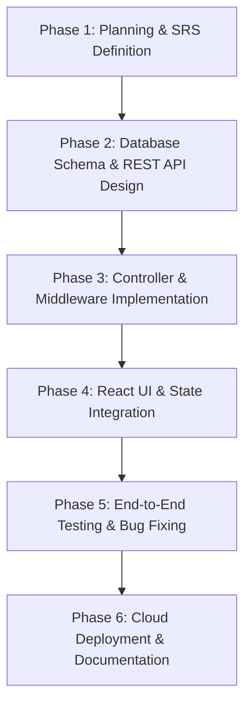

# ICT ACADEMY OF KERALA
## Summer Internship Report
### Full Stack Application Development with ReactJS

---

**Project Title:** QuickHire – Career Portal & Placement Management System  
**Domain:** Web Application Development / MERN Stack  
**Candidate Name:** Aradhana Rose  
**Academic Institution:** Information & Communication Technology Academy of Kerala (ICTAK)  
**Submission Date:** October 2026  

---

## EXECUTIVE SUMMARY
The **QuickHire** web application is a full-stack recruitment and career management solution developed during the ICT Academy of Kerala (ICTAK) Summer Internship program in Full Stack Application Development with ReactJS. Traditional placement and hiring workflows often face challenges including fragmented communication, lack of status transparency for candidates, and cumbersome candidate tracking for recruiters. 

QuickHire bridges this divide by delivering a unified, responsive platform built on the MERN stack (MongoDB, Express.js, React.js, and Node.js). Key outcomes of the project include secure JWT-based role authentication (Job Seeker vs. Recruiter/Admin), dynamic job catalog searching and filtering, single-click candidate application workflows with duplicate submission prevention, and an interactive recruiter management dashboard featuring live applicant review and status progression. The project successfully achieved all functional, security, and performance milestones set forth in the ICTAK curriculum.

---

## 1. INTRODUCTION
Modern human resource management and university placement cells depend heavily on centralized, agile digital portals to connect talented individuals with hiring organizations. The internship project **QuickHire** was conceived to address the friction points inherent in traditional job application workflows. 

Existing job boards often suffer from complex user onboarding, opaque application statuses, and sluggish client interfaces. In this project, a modern Single Page Application (SPA) architecture was implemented using Vite and React.js on the frontend, coupled with a RESTful Express.js backend and cloud-hosted MongoDB Atlas database. The application ensures seamless data delivery, strong input sanitization, and responsive interfaces catering to both desktop and mobile users.

---

## 2. OBJECTIVES
The primary objectives of the QuickHire capstone project were:
1. **Architect a Scalable Full-Stack Solution:** Design and implement a MERN application following clean separation of concerns across models, views, controllers, and services.
2. **Implement Role-Based Access Control (RBAC):** Provide granular security ensuring candidates access job discovery and personal application tracking, while recruiters access job authoring, editing, and candidate screening.
3. **Enhance State Management & UX:** Deliver robust frontend state handling covering all four mandatory UI states: *Loading*, *Success*, *Empty*, and *Error* states with contextual retry actions.
4. **Enforce Security & Data Integrity:** Protect sensitive credentials with salted bcrypt hashing, secure HTTP headers, centralized error middleware, and JWT validation.
5. **Develop Industry-Grade Engineering Skills:** Gain end-to-end expertise in version control (Git/GitHub), API contract design, cloud database configuration (MongoDB Atlas), and production deployment (Vercel & Render).

---

## 3. SCOPE AND DELIVERABLES

### Scope
The project scope encompassed both user-facing portals and administrative management tools:
- **Candidate Scope:** Account registration/login, keyword search, faceted filters (Category, Job Type, Location), modal application submission (contact info, resume link, cover letter), and personal application status tracking (*Pending*, *Reviewing*, *Shortlisted*, *Rejected*).
- **Recruiter Scope:** Secure recruiter authentication, job creation wizard, editing and deletion of job listings, review of received candidate submissions, and status progression tools.

### Deliverables
1. **Source Code Repository:** Structured into modular `client/` and `server/` directories with `.gitignore`, `.env.example`, and an informative `README.md`.
2. **Software Requirements Specification (SRS):** Document outlining functional requirements, non-functional targets, user stories, and use-case diagrams.
3. **Live Deployed Application:** Fully accessible cloud-hosted instances on Vercel (frontend) and Render (backend API) linked to MongoDB Atlas.
4. **Final Internship Report:** Comprehensive technical report complying with the official ICTAK document structure.

---

## 4. METHODOLOGY
The project adopted the **Agile Software Development Life Cycle (SDLC)** with iterative milestones:



### Architectural Pattern
- **Client Tier:** React (Vite) Single Page Application utilizing React Router DOM for routing, Context API for authentication state, and Axios/Fetch API client abstraction.
- **Server Tier:** Express.js running on Node.js, structured around the Model-View-Controller (MVC) design pattern with decoupled route declarations, controller logic, and centralized error handling middleware.
- **Database Tier:** MongoDB Atlas cloud cluster managed via Mongoose Object Data Modeling (ODM) schemas with strict type definitions and compound indexes.

---

## 5. PROJECT ACTIVITIES

| Milestone | Key Tasks & Activities | Tools / Tech Utilized |
| :--- | :--- | :--- |
| **Milestone 1: Project Initiation** | Defined problem statement, user personas, MVP scope, and draft SRS document. | Markdown, Paatshala LMS |
| **Milestone 2: Server & Database Setup** | Configured Node.js/Express server, established MongoDB Atlas cluster, created Mongoose schemas (`User`, `Job`, `Application`). | Express, Mongoose, Atlas |
| **Milestone 3: Authentication & Security** | Built JWT issuance, password hashing using bcrypt, auth middleware, and role guard (`user` vs `recruiter`). | JSONWebToken, bcryptjs |
| **Milestone 4: REST API Endpoints** | Developed CRUD routes for jobs, search/filter query parsers, and candidate application submission logic. | Express Router, Postman |
| **Milestone 5: React Frontend Development** | Scaffolded Vite React client, built responsive components (Navbar, JobCard, FilterSidebar, Modal, StatsCard). | React.js, Lucide Icons, CSS3 |
| **Milestone 6: API Client Integration** | Connected React services to Express endpoints, handled asynchronous states (Loading, Success, Empty, Error). | Fetch API, React Hooks |
| **Milestone 7: Quality Assurance & Polish** | Validated edge cases, form validation, invalid inputs, responsive layout checks on mobile & desktop. | DevTools, Chrome Mobile Sim |
| **Milestone 8: Cloud Deployment** | Hosted client on Vercel, server on Render, verified CORS and production environment variables. | Vercel, Render, Git |

---

## 6. RESULTS & FINDINGS

### 6.1 Accomplishments
- **Full-Stack Functionality:** Built a seamless, zero-friction experience allowing candidates to discover openings and recruiters to manage applicants in real time.
- **Data Protection:** Implemented zero-plaintext password storage and strictly guarded endpoints. A user cannot delete or edit jobs posted by another recruiter.
- **Resilient UX:** Successfully implemented all four state presentations across every screen:
  - *Loading State:* Polished spinner animations during asynchronous fetches.
  - *Success State:* Clean card grids displaying badge tags, salary ranges, and company badges.
  - *Empty State:* Informative fallback graphics when no jobs or applications match user criteria.
  - *Error State:* User-friendly messages with one-click retry triggers.

### 6.2 Test Results Summary

| Test Case | Scenario Tested | Expected Result | Actual Result | Status |
| :--- | :--- | :--- | :--- | :--- |
| **TC-01** | Candidate Registration with valid email | User created, JWT token generated | Status 201 Created | PASS |
| **TC-02** | Registration with duplicate email | Error returned, no duplicate account | Status 409 Conflict | PASS |
| **TC-03** | Candidate applies for active job | Application saved, linked to Job & User | Status 201 Created | PASS |
| **TC-04** | Candidate re-applies for same job | Duplicate rejected with notification | Status 409 Conflict | PASS |
| **TC-05** | Unauthorized user attempts job deletion | Access forbidden by role guard | Status 403 Forbidden | PASS |
| **TC-06** | Real-time search by keyword | Instant filtered list returned | Results matched | PASS |

---

## 7. CONCLUSION
The QuickHire Capstone Project successfully fulfilled all objectives defined in the ICT Academy of Kerala Summer Internship curriculum. By transitioning from conceptual requirements into a fully deployed production system, key competencies in MERN architecture, stateless authentication, responsive interface design, and cloud hosting were solidified. The resulting application serves as a robust, industry-ready foundation adaptable for enterprise hiring portals, university placement boards, and freelance marketplaces.

---

## APPENDIX

### A. Environment Configuration Reference

#### Server (`server/.env.example`)
```env
PORT=5000
MONGODB_URI=mongodb+srv://<username>:<password>@cluster0.avnewsh.mongodb.net/QuickHireDB?retryWrites=true&w=majority
JWT_SECRET=your_jwt_secret_key
CLIENT_URL=http://localhost:5173
NODE_ENV=development
```

#### Client (`client/.env.example`)
```env
VITE_API_URL=http://localhost:5000/api
```

### B. Core API Specification Summary
- `POST /api/auth/register` – Create user / recruiter account
- `POST /api/auth/login` – Authenticate user and receive JWT
- `GET /api/jobs` – Retrieve active jobs with keyword/category/type filters
- `POST /api/jobs` – Post new job vacancy (Recruiter only)
- `POST /api/applications/:jobId` – Submit job application (Candidate only)
- `GET /api/applications/my-applications` – Candidate application tracking
- `GET /api/applications/job/:jobId` – Recruiter applicant roster
- `PUT /api/applications/:id/status` – Update candidate status (Shortlist/Reject)
