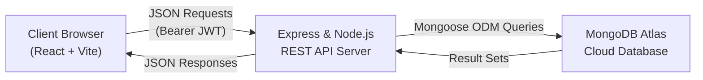
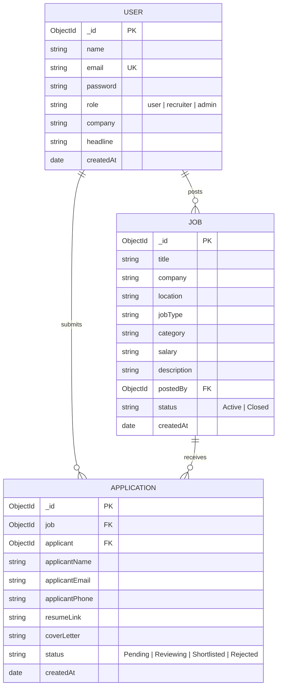

# SOFTWARE REQUIREMENTS SPECIFICATION (SRS)
## Project Title: QuickHire – Modern Career & Placement Management Portal
**Course:** Full Stack Application Development with ReactJS (MERN Stack)  
**Organization:** Information & Communication Technology Academy of Kerala (ICTAK)  
**Date:** October 2026  

---

## 1. Introduction

### 1.1 Purpose
The purpose of this document is to define the software requirements for **QuickHire**, a modern, responsive web application built on the MERN stack (MongoDB, Express.js, React.js, Node.js). QuickHire simplifies the hiring and placement workflow by bridging the gap between job seekers (candidates) and employers/recruiters.

### 1.2 Document Conventions
- **User / Candidate:** A job seeker who registers, browses openings, and applies.
- **Recruiter / Admin:** An employer or administrator authorized to post openings, review applicants, and manage hiring statuses.
- **MERN:** MongoDB (NoSQL Database), Express.js (Backend Web Framework), React.js (Frontend UI Library), Node.js (JavaScript Runtime).
- **JWT:** JSON Web Token for stateless authentication.

### 1.3 Intended Audience
- ICTAK Evaluators and Academic Mentors
- Development and Quality Assurance Team
- End Users (Candidates and Recruiters)

### 1.4 Project Scope
QuickHire provides an intuitive platform where:
- Candidates can discover career opportunities, filter by job type/category/location, submit structured applications with resume URLs, and monitor their application statuses in real-time.
- Recruiters can post vacancies, update job criteria, evaluate candidate submissions, and update hiring statuses (*Pending*, *Reviewing*, *Shortlisted*, *Rejected*).

---

## 2. Overall Description

### 2.1 Product Perspective
QuickHire operates as a decoupled single-page application (SPA). The frontend communicates with the RESTful backend API over HTTPS using JSON payloads. All sensitive operations are guarded by JWT-based role middleware.

### 2.2 User Roles & Characteristics

| User Role | Description & Permissions |
| :--- | :--- |
| **Guest / Public** | Can browse active job listings, search by keyword, filter by categories, and view company details. |
| **Candidate (User)** | Can register/log in, update profile, apply for jobs, and view submission history with status trackers. |
| **Recruiter / Admin** | Can post new jobs, modify/delete existing job listings, review received candidate applications, and update application statuses. |

### 2.3 Operating Environment
- **Client Side:** Modern web browsers (Chrome, Edge, Firefox, Safari) across desktop, tablet, and mobile devices.
- **Server Side:** Node.js (v18+) runtime environment running Express.js.
- **Database:** MongoDB Atlas (Cloud Cluster).
- **Deployment:** Vercel / Netlify (Frontend) and Render / Railway (Backend API).

---

## 3. Specific System Requirements

### 3.1 Functional Requirements (FR)

#### Module 1: Authentication & User Management
- **FR-01:** System shall enable new users to register with name, email, password, and designated role (`user` or `recruiter`).
- **FR-02:** Passwords must be hashed using bcrypt before storage in MongoDB.
- **FR-03:** System shall authenticate users upon login and issue a signed JSON Web Token (JWT).
- **FR-04:** Protected endpoints shall validate the JWT bearer token on every request.

#### Module 2: Job Catalog & Discovery
- **FR-05:** Anyone can view active job listings without requiring immediate login.
- **FR-06:** Users can search jobs in real-time by keyword (title, company, description).
- **FR-07:** Users can filter listings by Job Type (Full-time, Part-time, Remote, Internship) and Category (Engineering, Design, Marketing, Data, Support).
- **FR-08:** System shall support pagination to optimize performance.

#### Module 3: Candidate Application Workflow
- **FR-09:** Authenticated candidates can submit an application with contact details, resume/portfolio URL, and cover letter.
- **FR-10:** System shall enforce unique constraints so candidates cannot apply more than once for the same vacancy.
- **FR-11:** Candidates can view "My Applications" displaying applied jobs and current hiring progress (*Pending*, *Reviewing*, *Shortlisted*, *Rejected*).

#### Module 4: Recruiter Dashboard & Management
- **FR-12:** Recruiters can post new vacancies with title, company, salary, experience, description, and requirements.
- **FR-13:** Recruiters can edit or delete job postings they have created.
- **FR-14:** Recruiters can view an applicant roster for each job, inspect resumes, and change applicant status with recruiter notes.
- **FR-15:** Recruiter dashboard provides aggregated metric cards (Total Jobs Posted, Total Applications, Shortlisted Count).

---

### 3.2 Non-Functional Requirements (NFR)

| Parameter | Specification |
| :--- | :--- |
| **Performance** | API responses delivered in < 250ms under normal load; client pages load in < 1.5s. |
| **Security** | Passwords hashed using bcrypt (10 rounds); JWT tokens stored safely; CORS restricted to allowed client domains; NoSQL injection prevention via Mongoose schema casting. |
| **Reliability & Availability** | Database hosted on MongoDB Atlas with high availability; automatic server restarts via process managers. |
| **Usability & Responsiveness** | Clean, accessible design (WCAG compliance), mobile-first layout tested across viewport widths (320px to 1920px). |
| **Error Handling** | Every screen provides 4 user states: *Loading* (spinners/skeletons), *Success* (data render), *Empty* (helpful fallback), and *Error* (retry button). |

---

## 4. Database & Entity Design

---

## 5. API Endpoints Specification

| Method | Endpoint | Access | Purpose |
| :--- | :--- | :--- | :--- |
| `POST` | `/api/auth/register` | Public | Register new candidate or recruiter |
| `POST` | `/api/auth/login` | Public | Login user and issue JWT |
| `GET` | `/api/auth/me` | Private | Retrieve current user profile |
| `GET` | `/api/jobs` | Public | Get all active jobs (filter + search + paginate) |
| `GET` | `/api/jobs/:id` | Public | Get detailed view of single job |
| `POST` | `/api/jobs` | Recruiter | Create a new job vacancy |
| `PUT` | `/api/jobs/:id` | Recruiter | Update an existing job vacancy |
| `DELETE`| `/api/jobs/:id` | Recruiter | Delete job and associated applications |
| `GET` | `/api/jobs/my-jobs` | Recruiter | Get all jobs posted by the logged-in recruiter |
| `POST` | `/api/applications/:jobId` | Candidate | Submit job application |
| `GET` | `/api/applications/my-applications`| Candidate | View all applications submitted by candidate |
| `GET` | `/api/applications/job/:jobId` | Recruiter | View applicants for a specific job |
| `PUT` | `/api/applications/:id/status` | Recruiter | Update applicant status (Shortlist/Reject/Review) |
| `GET` | `/api/applications/recruiter-stats` | Recruiter | Get dashboard summary metrics |
